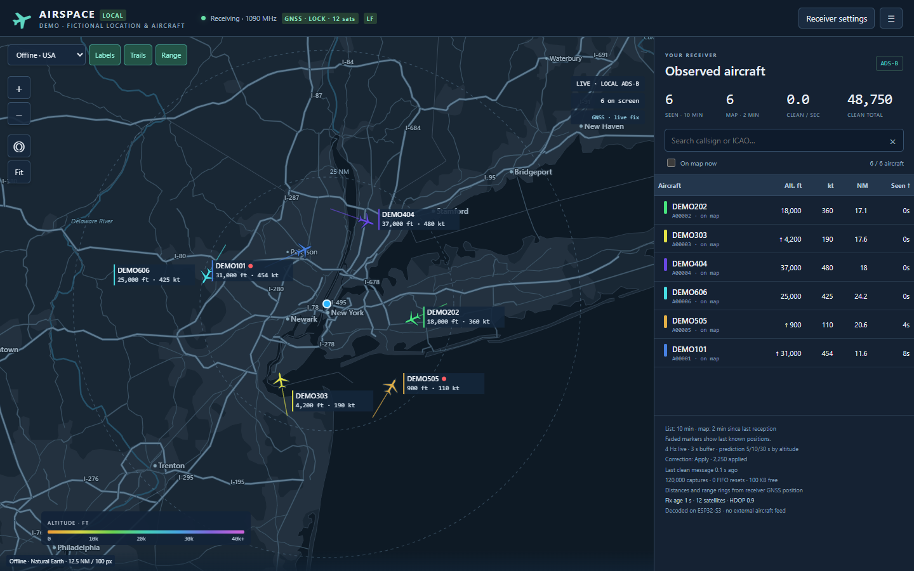
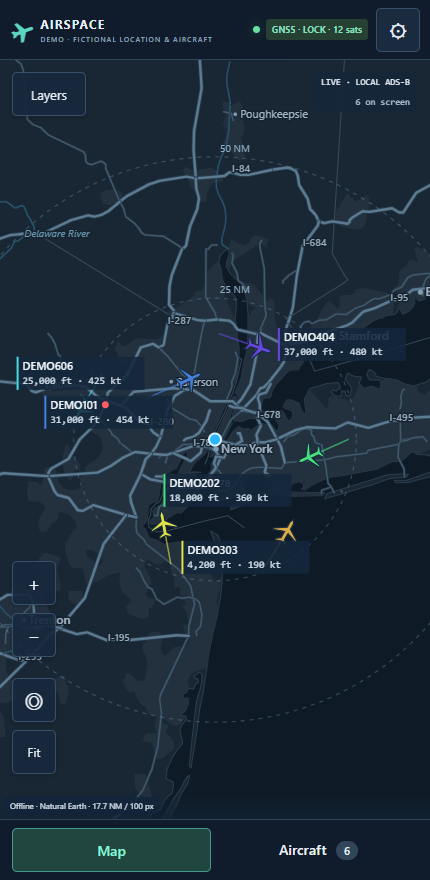

# ESP32s3 LR2021 ADSB receiver

A standalone **1090 MHz ADS-B receiver** built around the Meshnology W12's
ESP32-S3 and LR2021 radio. The LR2021 captures OOK/Manchester traffic; the S3
validates CRCs, decodes aircraft messages, tracks aircraft, and serves the web UI.
No Raspberry Pi, SDR dongle, cloud aircraft feed, or internet connection is
required for reception and the bundled US map.

In testing, this receiver successfully received aircraft telemetry from planes
**150 nautical miles (about 278 km) away with an indoor 915 MHz antenna**. This is an
observed result from the modified LF setup; range varies with aircraft altitude,
antenna placement, obstructions and interference.

**Experimental receiver firmware.** 1090 MHz is outside the LR2021's published
receive bands and the W12 RF front ends' intended bands. This works on the
tested, modified W12; it is not a guaranteed substitute for a purpose-built
1090 MHz receiver. This firmware only receives RF.

[Download a release](https://github.com/thefatmoop/esp32s3-lr2021-adsb-receiver/releases) ·
[Hardware and filter modification](docs/HARDWARE.md) ·
[Flashing and setup](docs/INSTALL.md) · [Build from source](docs/BUILD.md)

## Web interface

*Screenshots use fictional aircraft, a demonstration receiver position near New
York, and a placeholder network. They do not show an actual installation's
location or captured flight history.*

## Features

- LR2021 hardware Manchester decoding, CRC validation and ADS-B interpretation
  on the ESP32-S3; callsign, altitude, position, ground speed, heading and climb.
- Optional conservative one-bit recovery with known-aircraft and plausibility
  checks. Off / Observe / Apply modes; recovered counts and percentages in
  Receiver diagnostics. Clean message rates remain separate. Two-bit recovery
  is not implemented.
- 4 Hz local data updates and refresh-rate browser animation with a cached
  basemap. Trails and aircraft share the same display timeline.
- Three-second position buffer; constant-speed/bearing prediction for up to
  5 seconds below 1,000 ft, 10 seconds at 1,000–5,000 ft, and 30 seconds above
  5,000 ft without contact. Unknown altitude uses 5 seconds. Prediction also
  stops at the corresponding limit beyond the last actual position fix.
  Altitude is the reported altitude, not height above terrain. A red dot marks
  more than three seconds without contact. Prediction affects only the display.
- Aircraft stay in the list for ten minutes and on the map for two minutes
  after last reception. The receiver keeps short trails in RAM for new browsers.
- Dark offline map with USA roads, cities, waterways and state boundaries,
  including Alaska and Hawaii; optional online street tiles.
- GNSS receiver dot, lock status, last-good-position persistence, and follow
  mode. Dragging releases follow mode. No receiver location is built in.
- OLED pages rotate through reception, Wi-Fi status/IP/RSSI, and GNSS data.
- Wi-Fi provisioning AP, saved-network reconnect, and ten-minute setup timeout
  followed by reboot/retry for router power-outage recovery.
- Configurable Beast or AVR TCP output, default Beast port 30005, two clients.
- Optional browser-side aircraft model/photo lookup when internet is available.

## What to buy

| Item | Requirement |
| --- | --- |
| **Meshnology W12** | ESP32-S3R8 + LR2021, 16 MB flash, 0.96-inch OLED. Other ESP32 LoRa boards are not interchangeable. [Amazon: W12 ESP32 LoRa Development Board, LR2021 Chip Upgraded ESP32-S3](https://www.amazon.com/dp/B0H74Y877D) · [Manufacturer product page](https://meshnology.com/fr/products/meshnology-w12-lr2021-ultra-long-range-lora-meshtastic-device-kit). |
| **1090 MHz antenna** | 50 Ω ADS-B antenna. The kit's 868/915 MHz antenna is not the intended antenna for this application. |
| **RF pigtail/adapters** | Board-compatible IPEX/u.FL-style connector to your antenna connector; verify connector type and SMA gender against your board and antenna. |
| **USB-C data cable and 5 V supply** | Required for flashing and operation. A charge-only cable cannot flash firmware. |
| **Compatible GNSS module** | Optional W12 L76K GNSS module/cable for the receiver position. Reception itself works without GNSS. |
| **Enclosure and mounting hardware** | Optional printable [lid](hardware/enclosure/lid.stl) and [back](hardware/enclosure/back.stl). Screws, RF bulkhead and wiring must suit your parts. |
| **Rework materials** | Fine insulated jumper wire, flux, magnification, fine tweezers and suitable soldering/rework tools for the LF filter bypass. |

The manufacturer describes the W12 hardware and GNSS accessory in its
[W12 documentation](https://wiki.meshnology.com/W12/W12_LR2021_Ultra_Long_Range_LoRa_Device/).
Confirm the actual board revision before modifying it; the firmware pinout is
for the W12 described in this project, not the W15 or an SX1262 board.

## Quick start

1. Read the [hardware guide](docs/HARDWARE.md). For the tested LF arrangement,
   remove the U12 SAW filter and bridge **pads 1 and 4**, then connect the
   1090 MHz antenna to the **LF/sub-GHz port**.
2. Flash the release's factory image using the [installation instructions](docs/INSTALL.md).
3. Join **W12-ADSB-SETUP**, password **12341090**, and open
   **http://192.168.4.1/setup**. Enter your own 2.4 GHz Wi-Fi credentials.
4. Read the assigned IP on the OLED and open it in a browser on the same LAN.
   The offline map works without internet. Click **Center and follow GNSS**
   when a receiver position is available, or pan/zoom freely.
5. Check Receiver diagnostics for the decoder self-test, received messages,
   FIFO resets and one-bit recovery count. Defaults use LF, gain 13, boost 7,
   threshold 40, hardware Manchester and interrupt wake. Correction starts
   in **Observe**; select **Apply** if you want accepted recoveries forwarded.

Do not expose the web UI or TCP listener directly to the internet. They are
intended for your local network, not authenticated public hosting. The setup
password is deliberately a public provisioning default, not a home-network
credential. Wi-Fi credentials and the last GNSS fix are stored locally in NVS.

## Enclosure

The **GNSS module and internal 2.4 GHz antenna are hot-glued into place** in
the pictured build. The photographs are exact 90-degree rotations of the
originals; no components, OLED values or labels have been generated or retouched.
Download the [two printable enclosure parts](hardware/enclosure/README.md).
Assembly needs **one M3×8 mm screw**. Remove the included OLED screen cover
and reuse its screws to secure the board in the printed case.
This release includes STL meshes, not editable parametric CAD.

## Limitations

Overlapping messages, weak signals and LR2021 capture constraints can still
cause losses. Single-bit correction cannot recover arbitrary collisions.
Surface-position decoding and 978 MHz UAT are not provided. TCP timestamps
are software-derived and are not suitable for precision MLAT; Beast signal
amplitude is unavailable. Online tiles and optional aircraft lookup need
internet; local reception, diagnostics and the offline map do not.

## License and credits

Firmware is distributed under **GPL-3.0-or-later**. See [LICENSE](LICENSE) and
[THIRD_PARTY.md](THIRD_PARTY.md) for upstream radio work, map sources and other
credits. This is an independent experimental project, not an official product
from Meshnology or Semtech.
