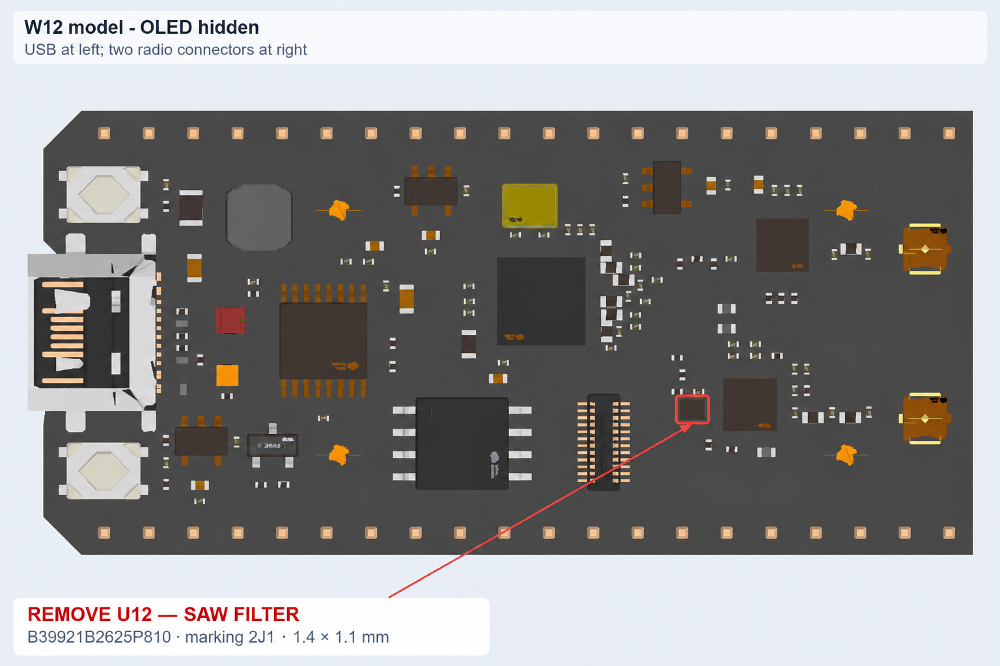
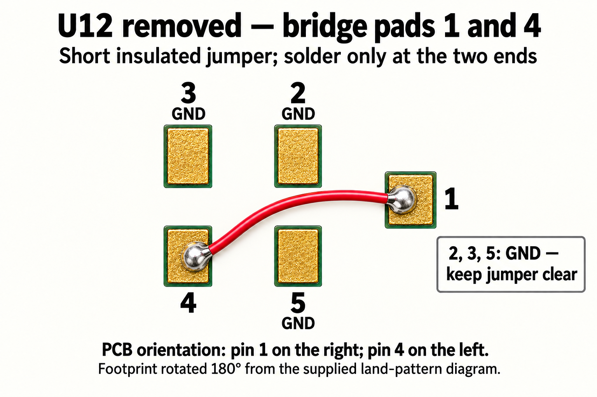
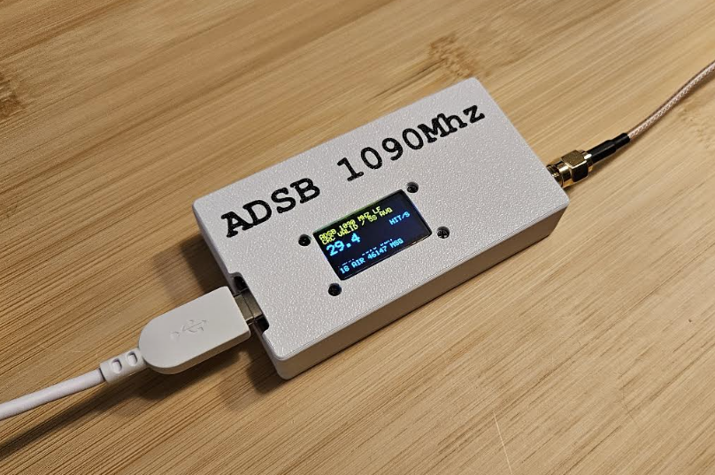
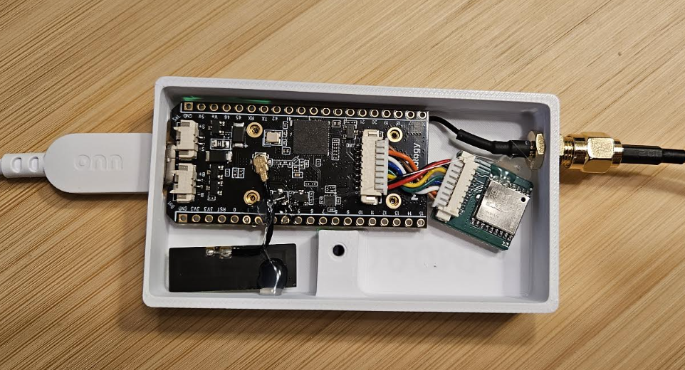

# Hardware assembly and LF filter bypass

Board: [W12 ESP32 LoRa Development Board, LR2021 Chip Upgraded ESP32-S3 on Amazon](https://www.amazon.com/dp/B0H74Y877D).

Use the **Meshnology W12 ESP32-S3 + LR2021** board. Check the part numbers,
connector layout and revision before following the pictures. The enclosure
photos show one completed build, not a universal wiring template.

## Why bypass U12?

On the documented W12, U12 is a **B39921B2625P810 (B2625)** SAW filter,
marking **2J1**, approximately **1.4 × 1.1 mm**. Its 902–928 MHz passband is
unsuitable for 1090 MHz. It sits between the GC1109 receive output and the
LR2021 LF input. The stock filter severely attenuates the desired signal.

The HF / 2.4 GHz connector also works for 1090 MHz reception without removing
U12, but showed significantly reduced range compared with the filter-bypassed
LF path in this project's tests. Select HF in Receiver settings when using
that connector. For the better-performing configuration, bypass U12, use LF,
and select LF in the UI (the release default).

References: [W12 schematic](https://wiki.meshnology.com/assets/files/W12-MB-V0.2%281%29-b62d4b0929d59c1a3c9ca5847eb65bf8.pdf),
[B2625 datasheet](https://www.mouser.com/datasheet/2/842/Qualcomm_B39921B2625P810-3074496.pdf).
The schematic file is named V0.2 while some internal sheets say V0.1.

## Locate and remove the filter

This annotated board-model illustration has USB on the left and radio antenna
connectors on the right. Confirm **U12 / 2J1** against your physical board and
schematic. Do not remove a similarly sized part based on proximity alone.

1. Disconnect USB, the battery, and any other power source.
2. Remove the small U12 SAW filter without lifting the PCB pads.
3. Bridge **pad 1 to pad 4** with the shortest practical insulated jumper.
   In the illustrated physical orientation, **pin 1 is on the right** and
   **pin 4 is on the left**. The footprint is rotated 180° relative to the
   supplied land-pattern diagram.
4. Keep the jumper clear of ground pads **2, 3 and 5**. Solder only its ends.
   Inspect for solder bridges and check continuity before reconnecting power.
5. Attach the 1090 MHz antenna to the **LF/sub-GHz connector** and use LF in
   Receiver settings. Do not confuse it with the HF or Wi-Fi antenna connection.

These are assembly illustrations, not microscope photographs of solder joints.
The tested build uses a direct short jumper, with no added series capacitor at
U12. That describes this board modification; it is not a universal rule for
other front ends. The bypass removes filtering, so strong out-of-band signals
can overload reception. An appropriate external 1090 MHz receive filter can
be considered where interference is a problem.

This is small-component RF rework and can permanently damage the board. The
front end remains outside its specified operating band. Do not transmit with
this experimental firmware or assume that a modified board retains its
original RF characteristics.

## Enclosure and accessory placement

The **GNSS module and internal 2.4 GHz antenna are hot-glued into place** in
this build. Secure the coax and module leads so they do not pull on connectors;
keep antenna elements and GNSS reception surfaces clear of metal hardware.
USB enters at the left and the external antenna bulkhead is at the right in
these photos.

Printable parts: [lid.stl](../hardware/enclosure/lid.stl) and
[back.stl](../hardware/enclosure/back.stl). Assembly requires **one M3×8 mm
screw**. Remove the included OLED screen cover and reuse its screws to secure
the board in the 3D-printed case. Check dimensions and fit in your slicer before
printing, especially if using a different board revision or cable set.

## Firmware pin assumptions

The radio uses W12 SPI NSS/SCK/MOSI/MISO on GPIO 8/9/10/11, reset on GPIO 12,
BUSY on GPIO 13, and interrupt on GPIO 7. The OLED is on I2C GPIO 17/18,
address 0x3C, with peripheral power/reset on GPIO 45/47. The optional GNSS
UART receives at 9600 baud on GPIO 39; GPIO 48 enables its supply.
The firmware configures receive front-end control; it does not expose PA
transmission settings. See the source and schematic before adapting boards.
